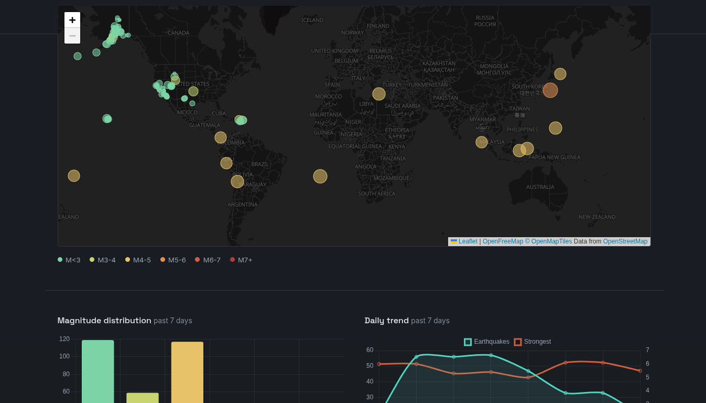

<h1 align="center">🌍 EarthPulse</h1>

<p align="center">
  A free, ad-free earthquake and severe-weather dashboard that runs <b>with no server, no API keys and no accounts</b>.<br>
  Fork it, flip two switches, and you have your own live copy in about two minutes.
</p>

<p align="center">
  <a href="https://ruhrabin.github.io/earthpulse/"><b>Live demo</b></a> ·
  <a href="#deploy-your-own-copy">Deploy your own</a> ·
  <a href="CONTRIBUTING.md">Contribute</a> ·
  <a href="#roadmap--help-wanted">Roadmap</a>
</p>

<p align="center"></p>

## What you get

- **World map** of the last 24 hours of earthquakes, sized and coloured by magnitude
- **Summary stats**: quake count, strongest quake, average magnitude, active US weather alerts
- **Charts**: magnitude distribution and a 7-day trend
- **Searchable table** of significant quakes (M4.5+ over 30 days)
- **US severe-weather alerts** from the National Weather Service, grouped by type
- **A history file** (`data/history.csv`) that grows every day, so you own the data
- **Earthquake safety guidance**

## Why it is different

Most dashboards need a database, a backend, or a paid hosting plan. EarthPulse needs only GitHub:

| | |
|---|---|
| **Data updates** | A GitHub Actions cron job fetches the feeds every 15 minutes and commits the result |
| **Hosting** | GitHub Pages |
| **Backend / database** | None |
| **API keys, secrets, third-party accounts** | None |
| **Build step** | None (plain HTML, CSS and JavaScript ES modules) |
| **Script dependencies** | Python standard library only |

That makes it easy to read, easy to fork, and cheap to keep running forever.

## Deploy your own copy

1. **Fork** this repository.
2. **Settings → Actions → General → Workflow permissions** → choose *Read and write permissions*.
3. **Settings → Pages** → Source: *Deploy from a branch* → branch `main`, folder `/ (root)`.
4. **Actions** tab → open *Update hazard data* → **Run workflow**.
5. Your site appears at `https://<your-username>.github.io/<repo-name>/`.

## How it works

```
USGS earthquake feeds ─┐
                       ├─► scripts/fetch_earthquake_data.py ─► data/latest.json
NWS alerts API ────────┘      (GitHub Actions, every 15 min)   data/history.csv
                                                                    │
                          index.html + js/*.js (MapLibre GL) ◄──────┘
                          served by GitHub Pages
```

Map tiles come from [OpenFreeMap](https://openfreemap.org/). The JavaScript is split into small modules (`map.js`, `charts.js`, `table.js`, `alerts.js`, `stats.js`) so each part can be understood on its own.

## Data sources

- [USGS Earthquake Hazards Program](https://earthquake.usgs.gov/) GeoJSON feeds
- [National Weather Service](https://www.weather.gov/documentation/services-web-api) alerts API (United States only)
- [OpenFreeMap](https://openfreemap.org/) base map

Please credit these sources if you publish your own copy.

## ⚠️ Not an official warning system

EarthPulse is for awareness and education. Data refreshes every 15 minutes, which is **too slow for life-safety alerts**. In an emergency, follow your national authorities and official alert channels.

## Roadmap &amp; help wanted

Pick anything below. Items marked 🟢 are small and beginner-friendly, and each has (or will have) a matching issue labelled `good first issue`.

- [ ] 🟢 Light / dark theme toggle
- [ ] 🟢 SRI hashes on the CDN `<script>` tags (supply-chain hardening)
- [ ] 🌐 **Translations** (many high-risk regions are not English-first). Start with the i18n groundwork, then add your language
- [ ] Per-country / per-region breakdown view
- [ ] More hazard types: wildfires, volcanic activity, tsunami warnings (each needs a free, key-less data source)
- [ ] Long-range historical chart once `data/history.csv` has enough rows
- [ ] Push notifications via a service worker for M6+ events
- [ ] React / Next.js rewrite *(only if it keeps the zero-cost, zero-server property)*

New ideas are welcome. Open an issue or start a discussion.

## Contributing

Read [CONTRIBUTING.md](CONTRIBUTING.md). In short: fork, make a small change, open a pull request. You do not need to be an expert. Translations, documentation fixes and bug reports are all real contributions.

[Questions or ideas? Join the Discussions tab.](https://github.com/RuHRabin/earthpulse/discussions)

## License

[MIT](LICENSE). Data belongs to the respective providers and is subject to their terms.
